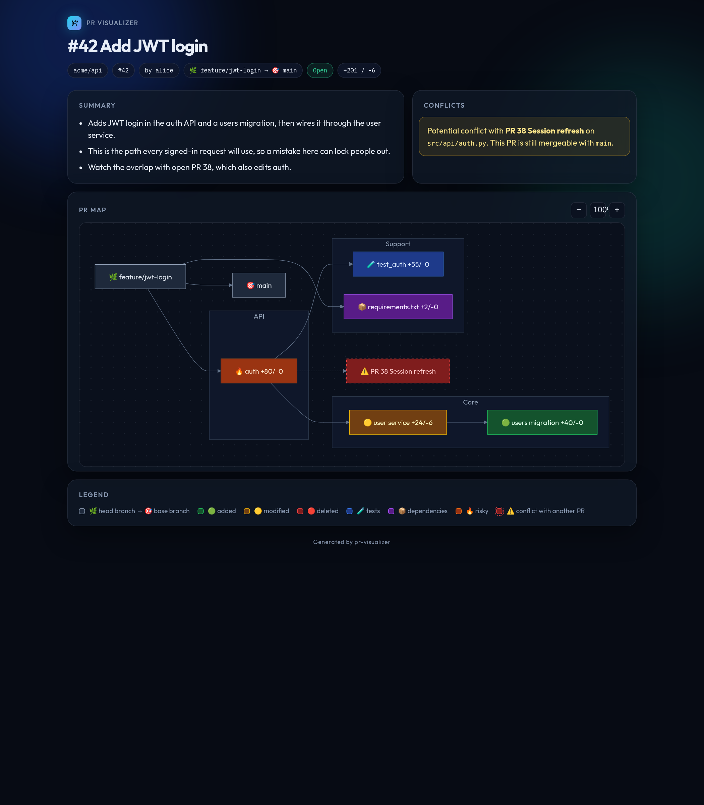

# PRism 🔺

PRism turns a GitHub pull request into a visual HTML page, so you can see what the PR does at a glance.

The page includes:

- A short summary
- The PR type (new feature, bug fix, and so on)
- Before and after
- Affected features
- A risk meter from 1 to 10
- A suggested review path
- Conflicts with other open PRs
- A Mermaid PR map — click a module to see its files
- Auto-generated files, shown muted on the map
- Light and dark mode

It can also rank every open PR waiting on your review, so you know which one to open first.



## Install

You need the [GitHub CLI](https://cli.github.com/) (`gh`) installed and logged in.

Copy these three files into your Claude Code skills folder:

```bash
mkdir -p ~/.claude/skills/prism
cp SKILL.md template.html queue-template.html ~/.claude/skills/prism/
```

## Usage

In Claude Code, run:

```text
/prism <PR number or URL> [save]
```

Examples:

```text
/prism 42
/prism https://github.com/OWNER/REPO/pull/42
/prism 42 save
```

By default, the page is written to `./.prism/pr-<N>.html` and kept out of git. Add `save` to write it to `./prism-output/` instead.

Open the page in a browser, or copy the `open` command from the chat reply.

### Review queue

```text
/prism queue
/prism queue all
```

`/prism queue` ranks the open PRs in the current repo that are waiting on your review (including review requests to your teams). `/prism queue all` does the same across every repo.

Each PR gets a quick risk score from its file paths and line counts. No diffs are read, so it stays fast. Shared files between PRs in the queue count as a conflict risk. The page shows the score, title, repo, author, age, size, a draft badge, the top reasons, and a `/prism` command to copy for a deep dive.

The page is written to `./.prism/queue.html`. With more than 15 PRs across all repos, PRs are scored on size alone.
