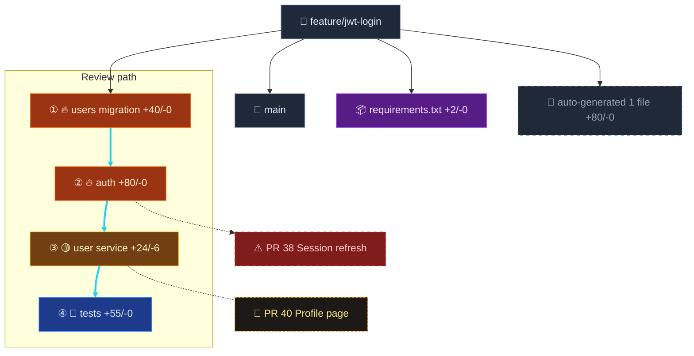

# PRism 🔺

Show a clear flowchart of a GitHub pull request, or of your own branch before a PR exists. Follow these steps in order. Do not skip steps. Use plain language in the HTML and in your short chat reply.

There are two modes:
- **PR mode** — a PR already exists. This is the normal flow.
- **Author mode** — you are on your own branch and there is no open PR yet. Same page, plus a suggested PR description.

**Review queue:** if the input starts with `queue` (for example `/prism queue` or `/prism queue all`), skip steps 1-12 and follow **Review queue** at the end of this file instead.

## 1. Parse the input

Input: $ARGUMENTS (for example `/prism 23`, `/prism https://github.com/OWNER/REPO/pull/23`, `/prism 23 since`, `/prism`, or `/prism branch base=develop`). Options can come in any order after the PR or `branch`: `since [sha]`, `comment`, `post`, `base=<name>`, `+uncommitted`, `save`.

**A PR number or URL was given → PR mode:**

- If the user gave a number, use that number in the current repo.
- If the user gave a URL like `https://github.com/OWNER/REPO/pull/123`, use repo `OWNER/REPO` and number `123`. Pass `--repo OWNER/REPO` to every `gh` command.
- If the input has `since` after the PR (for example `/prism 42 since` or `/prism 42 since abc1234`), turn on **since mode** (step 3). `since` alone means "since my last review". `since <sha>` means "since this commit".
- `save` — keep the page in `prism-output/` (step 9).
- `comment` — also write a Markdown comment for the PR (step 10) and offer to post it (steps 11–12). It always describes the full PR: if the input has both `since` and `comment`, ignore `comment` and say so in the reply.
- `post` — only with `comment`: the user already said yes to posting, so post without asking. Use it only when the word `post` is literally in the input (typed by the user or set in their GitHub workflow). Never assume it.
- First run `gh auth status`. If it fails, stop and tell the user to run `gh auth login`.
- Check if the current folder is a local clone of the PR's repo. Run `gh repo view --json nameWithOwner -q .nameWithOwner`. It is local if that prints the PR's `OWNER/REPO` (ignore case), or if `git remote -v` lists `OWNER/REPO` (for forks). If the command fails (no git repo) or names a different repo, it is **not local**. Remember this for step 7.

**Input is empty or says `branch` → check the current branch:**

1. If the input is empty and the user wrote a PR number or link in chat, use PR mode with it.
2. Run `git rev-parse --is-inside-work-tree`. If it fails, this is not a git repo: ask for a PR number or link, and stop.
3. Run `git branch --show-current`. If it prints nothing (detached HEAD), ask the user to check out a branch or give a PR, and stop.
4. Run `gh auth status`. If it passes, run:

   ```bash
   gh pr view --json number,state --jq 'select(.state == "OPEN") | .number'
   ```

   If it prints a number, this branch already has an open PR: use PR mode with that number.
5. Otherwise (no PR, only a merged or closed one, or `gh` is missing or not logged in), use **author mode**. In author mode `gh` is optional; only the open-PR conflict check needs it. The repo is always local in author mode, and `since` does not apply.

## 2. Collect the facts with the script

The script `prism_collect.py` (in the skill folder, next to this file) does the counting, grouping, conflict check, and risk score. Its numbers are the source of truth. Do not recount lines, regroup files, or redo the risk math yourself.

1. Run it. `<tmp>` is `"${TMPDIR:-/tmp}/prism-<N>.json"` (use `prism-branch.json` in author mode).
   - PR mode: `python3 ~/.claude/skills/prism/prism_collect.py <N or URL exactly as given> --save <tmp>`
   - Since mode: add `--since last` (for `since` alone) or `--since <sha>`.
   - Author mode: `python3 ~/.claude/skills/prism/prism_collect.py --branch --save <tmp>`, plus `--base <name>` for `base=<name>` and `--uncommitted` for `+uncommitted` (or when the user asks in chat to include uncommitted or working changes).

   Use the skill folder you are reading this from; in a project it may be `.claude/skills/prism/`.
2. If it exits non-zero, stop and tell the user its `message`. Exit 2: install `gh`. Exit 3: run `gh auth login`. Exit 4: wrong input (bad PR number or link, not a git repo, no base branch, or nothing to compare). Exit 5: `gh` or `git` failed.
3. It prints one short JSON object (long file lists are cut to 10, with the rest counted in `files_more`; the saved file has everything):
   - `pr` — `mode` (`pr`, `since`, or `branch`), repo, number, title, url, author, state, base, head, mergeable, body, commits. Author mode adds `base_ref`, `safe_name` (the branch name made safe for file names), `commit_count`, `uncommitted_files`, `includes_uncommitted`, and `pushed`.
   - `since` — only when `--since` was given. See step 3.
   - `totals.real` and `totals.all` — files, additions, deletions for real code and for all files. `totals.generated` is the muted part. Since mode adds `totals.full_pr` and `totals.full_pr_real`.
   - `tests` — `present`, `thin`, `needed`, and line counts.
   - `conflicts` — see step 4.
   - `risk` — `score`, `level`, `percent`, and `reasons` (points and why, biggest first).
   - `modules` — the map nodes: `id`, `label`, `status`, `mermaid_class`, `node_label`, `on_review_path`, `files`.
   - `read_plan` — `big`, `important_files`, `risky_files`.
   - Saved file only: `files` (every file with its flags) and `files_json` (ready for `{{FILES_JSON}}`, with a GitHub diff `url` per file in PR and since mode).
4. Read the code so you can write the prose (what each module does). Skip generated files.
   - If `read_plan.big` is `false`, read the whole diff: `gh pr diff <N>` in PR mode; the delta diff in since mode (step 3); `git diff <base_ref>...HEAD` in author mode (`git diff --merge-base <base_ref>` with uncommitted changes).
   - If `read_plan.big` is `true` (about 2000+ real lines or 40+ real files), do not read the full diff. Read only the files in `read_plan.important_files` (risky first, then the largest), one at a time. PR mode: `gh api repos/OWNER/REPO/pulls/<N>/files --paginate --jq '.[] | select(.filename=="PATH") | .patch'`. Author mode: `git diff <base_ref>...HEAD -- PATH`.

## 3. Since mode (skip this step without `since`)

The script compares the commit you last reviewed (or the `<sha>` you gave) with the PR head and puts the result in `since`:

- `since.nothing_new` is `true`: nothing changed since then. Do not write a page. Reply: "No new commits on PR <N> since your review on <date> (commit abc1234)."
- `since.fallback_reason` is set (you never reviewed it, or the old commit is gone after a force-push or rebase): the script used the full PR instead. Make the normal full-PR page with the fallback banner (step 9) that gives this reason, and say it first in chat.
- Otherwise (`pr.mode` is `since`): every list and number in the JSON covers only the delta. `since.from_short` is the starting commit, `since.reviewed_at` the review time (write it like `24 Nov 2026`), `since.total_commits` the new commit count, `since.commits` their headlines. "Before" means at your review and "After" means now. Conflicts stay PR-wide, because a merge takes the whole PR.
- If `since.files_capped` is `true`, add to the banner: "GitHub lists at most 300 files, so some may be missing." If `since.has_merge_commits` is `true`, say in the summary that the delta includes base-branch changes.
- To read the delta diff: `gh api repos/OWNER/REPO/compare/<since.from>...<pr.head_oid> -H "Accept: application/vnd.github.diff"`.

## 4. Conflicts (from the script)

If `conflicts.checked` is `false`, the PR is merged or closed: say conflicts are already resolved or no longer apply.

Otherwise read `conflicts`:

- `method` is `merge-tree` — the **real check** ran. The script fetched the base and the PR heads into private `refs/prism/*` refs, ran `git merge-tree` for this PR against the base and against each open PR that shares files, and deleted those refs again. It never checks out, touches the working tree, or changes the user's branches. It runs only in a full (not shallow) local clone of the PR's repo, with git 2.38 or newer.
- `method` is `file-overlap` — the fallback. `fallback_reason` says why in one short phrase (for example "not run in a local clone of OWNER/REPO", "git is older than 2.38", "shallow clone", or "git fetch failed"). The page must say it is file overlap only and why.
- `base_conflict` and `base_conflict_files` — this PR (or branch) conflicts with the base. In the fallback this is GitHub's `mergeable` = `CONFLICTING`.
- `overlaps` — other open PRs on the same base that touch the same `files`. Each has a `kind`:
  - `conflict` — a real conflict; `conflict_files` lists the clashing files (only files both PRs change).
  - `overlap` — same files, merges cleanly.
  - `potential` — file overlap only (fallback, or the check failed for that pair).
  - `generated_only: true` means they share only generated files such as a lockfile. Mention it briefly; it adds no risk.
  - `other_out_of_date: true` — add "PR M is also out of date with <base>".
- `error` — the open-PR part could not run (for example `gh` is missing in author mode). Say so in the note.

In author mode the base check runs locally against `<base_ref>` with no network, so it is only as fresh as the user's last fetch. Say "this branch" instead of "this PR".

## 5. How the script groups and classifies files

This is a summary of what `prism_collect.py` does, so you can explain it. Do not apply it by hand. If this text and the script ever disagree, the script wins.

**Generated** (muted): lockfiles (`package-lock.json`, `yarn.lock`, `pnpm-lock.yaml`, `go.sum`, any `*.lock`, and similar), `*.snap`, snapshot data files (migration or schema snapshots), `*.min.*`, and files under `dist/`, `build/`, `generated/`, `__generated__/`, `vendor/`, or `__snapshots__/`. They all go in **one** node, `GEN`: `🤖 auto-generated N files +X/-Y`. It is not on the review path and its lines are not in the "real code" totals. `totals.all` still counts every file.

**Classify** each real file:
- 🟢 added · 🟡 modified (renamed counts as modified) · 🔴 deleted
- 🧪 tests — files in folders like `test/`, `tests/`, `__tests__/`, `spec/`, `e2e/`, or named like `test_*.py`, `*_test.go`, `*.test.ts`, `*.spec.js`, `*Test.java`
- 📦 dependencies — manifests like `package.json`, `requirements.txt`, `pyproject.toml`, `go.mod`, `Cargo.toml`, `Gemfile` (lockfiles are generated, not this)
- 🔥 risky — path words for auth, security, or permissions (`auth`, `login`, `oauth`, `jwt`, `session`, `token`, `secret`, `permission`), migrations or schema, config (`config`, `settings`, `.env`, `Dockerfile`, `*.tf`), CI (`.github/workflows/` and similar), payments. Tests, deps, docs, and generated files are never risky.
- One status per file: generated, then tests, then deps, then deleted, then risky, then added or modified. So risky wins over added or modified, and tests stay 🧪.

**Overview map:** all tests go in one `TESTS` node, all dependency manifests in one `DEPS` node, and generated files in `GEN`. The other real files are grouped by top-level folder. If there is room, the biggest folder is split one level deeper. If there are too many groups, the smallest go into `OTHER` (`other N files`). The whole map is capped at about **10 nodes**, counting `HEAD` and `BASE`; conflict nodes come on top. The map shows modules only; the files are in `files_json`, so a click can reveal them.

## 6. Risk, review path, and diagram

**Risk meter 🔥** — use `risk.score`, `risk.level`, `risk.percent`, and `risk.reasons` as they are. This is the rubric the script applies, from file paths, line counts, and the migration diffs. "Lines" means real lines changed (adds + dels), with generated files left out. In since mode it scores the delta only; the conflict points still count.

1. **Sensitive code** (auth, permissions, security, payments). Lines changed in those files: under 50 = +1; 50-199 = +2; 200+, or a new login, token, or permission flow (a new sensitive file with 30+ added lines) = +3.
2. **Migrations or schema** (real ones, not only a generated snapshot): +1 if they only add; +2 if the added lines change or drop existing data (`ALTER TABLE`, `DROP`, `RENAME`, `UPDATE ... SET`, `DELETE FROM`, and the same in ORM migrations), or a migration is deleted.
3. **Config or CI**: +1
4. **Dependency manifests**: +1
5. **Size** of all real code: +1 for 300-999 lines, +2 for 1000-2999, +3 for 3000+.
6. **Tests** (skipped for docs/config-only changes and for code changes under 20 lines): no test files changed = +2; tests changed but thin (test lines under a quarter of the other real lines) = +1; tests changed alongside sensitive code or a migration, and not thin = −1.
7. **Conflicts** (count once): +2 for a real conflict with the base branch or another open PR (in the fallback: GitHub says `CONFLICTING`); otherwise +1 if another open PR touches the same real files (clean overlap, or file overlap only in the fallback).

Then cap at 10. The lowest score is 1, or 2 if sensitive code or a migration changed. Level: 1-3 low, 4-6 medium, 7-10 high.

Write one short plain reason per item in `risk.reasons`, with its points, biggest first (for example `New JWT login flow +3`). Do not add reasons the script did not give.

**Review path 🧭** — pick the order a reviewer should read the `modules`, usually: data/schema → core logic → API → clients → tests/docs. Skip modules with `on_review_path: false` (the generated node), branch nodes, conflict nodes, and overlap nodes. Number the path modules ① ② ③ in their labels. Draw the path with thick arrows `==>` in that order, then color those arrows cyan with `linkStyle` (link index starts at 0, in the order links appear; the example below shows this). For each step, write one plain line that says why to look there.

**Diagram** — use one node per entry in `modules`. Keep each module's `id` exactly as the node id, so `files_json` and the clicks match. Start from its `node_label` (`emoji label +adds/-dels`): you may shorten or rename the label text into plain words and add ① ② ③, but keep the emoji and the +/- numbers. Use `mermaid_class` in the `class` lines. Prefer `flowchart TB` so the review path reads top to bottom. Use a subgraph for the path, in order. Use fewer edges and fewer crossings. If you cannot infer flow, link `HEAD` to the first review node and to side nodes only. Other PRs from `conflicts.overlaps` (skip `generated_only` ones; if there are many, show the 2-3 with the most shared files):
- `kind` `conflict` or `potential` — class `conflict`, label `⚠️ PR 38 title`, linked `AUTH -.-> C38`.
- `kind` `overlap` — class `overlap`, label `🔀 PR 40 title`, linked without an arrowhead `USER -.- O40`.

Link each one from the module that holds the shared files. After every module node (including generated), add `click ID call showNode("ID")`.

**Colors** — always include these `classDef` rules:

```
classDef branch fill:#1e293b,stroke:#94a3b8,color:#e2e8f0
classDef added fill:#14532d,stroke:#22c55e,color:#dcfce7
classDef modified fill:#713f12,stroke:#eab308,color:#fef9c3
classDef deleted fill:#7f1d1d,stroke:#ef4444,color:#fee2e2
classDef tests fill:#1e3a8a,stroke:#3b82f6,color:#dbeafe
classDef deps fill:#581c87,stroke:#a855f7,color:#f3e8ff
classDef risky fill:#9a3412,stroke:#f97316,color:#ffedd5
classDef generated fill:#1f2937,stroke:#64748b,color:#94a3b8,stroke-dasharray:5 5
classDef conflict fill:#7f1d1d,stroke:#ef4444,color:#fecaca,stroke-dasharray:5 5
classDef overlap fill:#1c1917,stroke:#f59e0b,color:#fde68a,stroke-dasharray:3 3
```

**Mermaid syntax rules** (or the diagram will fail): unique ids of letters and numbers only (never `end`); always quote labels; avoid `()`, `[]`, and `#` even inside quotes (write `PR 38`, not `PR #38`); paste raw Mermaid into the template, no fences.

## 7. PR type, before/after, and affected features

Pick exactly one PR type from the title, commit messages, and diff:
- **New feature** — added files or routes that introduce a capability
- **Improves a feature** — extends or changes an existing capability
- **Bug fix** — fix/bug keywords and a small diff
- **Removes a feature** — removed files, routes, or a capability
- **Refactor (no behaviour change)** — renames or moves with no behaviour change
- **Docs/config** — only markdown, yaml, or config

**Before and after** — two short plain-English lines, from a user or developer view of app behaviour: `Before: ...` then `After: ...`.

**Affected features** — list existing features that use the changed code. If the repo is local (step 1), run `rg` for callers or imports of the changed functions and files (if `rg` is not installed, use `git grep -n`). Use a short name (2–4 words) for each. Mark each **breaking**, **may break**, **changed**, or **safe**, and output them in that order (breaking first, safe last). Put any short reason in the `title` attribute only, not as visible text. If a change is breaking (removed or renamed public API, changed config or env, a DB migration, or a changed response shape), mark it **breaking** and add the reason in `title`. If nothing existing is touched, write: `No existing features affected (new code only)`.

If the repo is **not local**, do not search and do not guess callers. Infer affected features only from the diff itself (the files and functions it changes), and add this note at the end of the Affected section: `Callers not checked — run /prism from a local clone of OWNER/REPO for a full check` (use the real `OWNER/REPO`).

## 8. Copy this style

Fake PR `#42` Add JWT login, `feature/jwt-login` → `main`, open, real code +201 / -6, total +281 / -6 because of one generated lockfile +80 / -0. Real check ran in a local clone: merges cleanly with `main`; real conflict with open PR 38 Session refresh in `src/api/auth.py`; open PR 40 Profile page also edits `src/services/user.py` but merges cleanly. Risk 7/10 high: new JWT login flow +3, adds a users migration +1, deps +1, real conflict +2, tests cover the login −1 (55 test lines next to 152 other real lines, so not thin).

PR type: New feature.
Before: The API had no JWT login, so users could not sign in with a token.
After: Users can sign in with a JWT. A users migration stores the new login data, and the user service wires it in.
Affected (pills, breaking first): Users database (breaking — adds a users migration); Auth API (may break — conflicts with open PR 38 in auth.py); User service (changed).

Review path: ① users migration → ② auth → ③ user service → ④ tests.



## 9. Write the HTML file

1. Read `template.html` from the skill folder (the folder this SKILL.md is in), usually `~/.claude/skills/prism/template.html`, or `.claude/skills/prism/template.html` in the project.
2. Replace these placeholders exactly:
   - `{{TITLE}}` — PR number and title. Example: `#42 Add JWT login`. Author mode: the suggested PR title, no number. Example: `Add JWT login`
   - `{{PR_URL}}` — the PR `url` from step 2, as plain text. Example: `https://github.com/acme/api/pull/42`. The page uses it to link every file to its diff on GitHub. If it is missing or wrong, files show as plain text. Author mode: an empty string (there is no PR to link to yet).
   - `{{META}}` — HTML chips. The first chip is always the PR type badge (see below):

     ```html
     <span class="pr-type-badge type-new">New feature</span>
     <span class="chip">owner/repo</span>
     <span class="chip">#42</span>
     <span class="chip">by alice</span>
     <span class="chip">🌿 feature/jwt-login → 🎯 main</span>
     <span class="chip chip-state open">Open</span>
     <span class="chip">real code +201 / -6</span>
     <span class="chip chip-muted">total +281 / -6</span>
     ```

     State chip: `chip chip-state open`, `merged`, or `closed`. Take "real code" from `totals.real` and "total" from `totals.all`.

     Author mode: no PR number chip. Use `by <git user.name>`, local branch names, and the draft state chip. Add a commit count chip (`pr.commit_count`), and an uncommitted chip when `pr.uncommitted_files` is more than 0:

     ```html
     <span class="pr-type-badge type-new">New feature</span>
     <span class="chip">owner/repo</span>
     <span class="chip">by alice</span>
     <span class="chip">🌿 feature/jwt-login → 🎯 main</span>
     <span class="chip chip-state draft">Draft (no PR yet)</span>
     <span class="chip">4 commits</span>
     <span class="chip">real code +201 / -6</span>
     <span class="chip chip-muted">total +281 / -6</span>
     <span class="chip chip-muted">3 uncommitted files not included</span>
     ```

     With `+uncommitted`, the last chip says `includes 3 uncommitted files`.

     In since mode, the "real code" and "total" chips count the delta only. Then add one muted chip with the full-PR totals, from `totals.full_pr`: `<span class="chip chip-muted">full PR +281 / -6 · 7 files</span>`.
   - `{{SINCE_BANNER}}` — an empty string in normal mode. In since mode:

     ```html
     <div class="since-banner">
       <strong>Changes since your review on 24 Nov 2026 (commit <code>abc1234</code>) — 3 new commits</strong>
       <span>5 files changed. Map, modules, risk, and review path cover only these changes.</span>
     </div>
     ```

     For `since <sha>`, start with "Changes since commit `abc1234`". Write "1 new commit" for one. For a fallback (never reviewed, force-push, or rebase), use `<div class="since-banner is-fallback"><strong>Showing the full PR</strong><span>...reason from step 3...</span></div>`.
   - PR type badge (goes inside `{{META}}`, first) — exactly one badge. Class: `type-new`, `type-improves`, `type-fix`, `type-removes`, `type-refactor`, or `type-docs`.

     ```html
     <span class="pr-type-badge type-new">New feature</span>
     ```

     Labels: New feature, Improves a feature, Bug fix, Removes a feature, Refactor (no behaviour change), Docs/config.
   - `{{BEFORE_AFTER}}` — two short plain-English lines:

     ```html
     <div class="before-after">
       <p><strong>Before:</strong> The API had no JWT login, so users could not sign in with a token.</p>
       <p><strong>After:</strong> Users can sign in with a JWT. A users migration stores the new login data, and the user service wires it in.</p>
     </div>
     ```

   - `{{AFFECTED}}` — existing features as one wrapping row of short-name pills, in this order: `is-breaking`, `may-break`, `changed`, `safe`. Put any reason in the `title` attribute only. If none:

     ```html
     <div class="affected">
       <h2>Affected features</h2>
       <p class="affected-empty">No existing features affected (new code only)</p>
     </div>
     ```

     Otherwise:

     ```html
     <div class="affected">
       <h2>Affected features</h2>
       <ul class="affected-list">
         <li><span class="feat-pill is-breaking" title="Adds a users migration">Users database</span></li>
         <li><span class="feat-pill may-break" title="Conflicts with open PR 38 in auth.py">Auth API</span></li>
         <li><span class="feat-pill changed">User service</span></li>
       </ul>
     </div>
     ```

     If the repo is not local, add the note as the last item inside `<div class="affected">`, after the list or the empty line:

     ```html
     <p class="affected-note">Callers not checked — run /prism from a local clone of OWNER/REPO for a full check</p>
     ```

   - `{{SUMMARY}}` — exactly three `<li>` bullets: what changed, why it matters, and any risk or conflict.
   - `{{CONFLICTS}}` — one box per kind, in this order, and skip empty kinds. End with one `conflicts-note` line that says how it was checked.
     - `conflicts-real` — real conflicts, with the base branch first, then other PRs. List the conflicted files.
     - `conflicts-overlap` — other PRs that edit the same files but merge cleanly.
     - `conflicts-ok` — the base check passed, or nothing was found.

     ```html
     <div class="conflicts-real">
       <p class="conflicts-head">⚠️ Real conflicts</p>
       <ul>
         <li><strong>PR 38 Session refresh</strong> conflicts in <code>src/api/auth.py</code></li>
       </ul>
     </div>
     <div class="conflicts-overlap">
       <p class="conflicts-head">🔀 Overlap, merges cleanly</p>
       <ul>
         <li><strong>PR 40 Profile page</strong> also edits <code>src/services/user.py</code></li>
       </ul>
     </div>
     <div class="conflicts-ok">Merges cleanly with <code>main</code> ✅</div>
     <p class="conflicts-note">Checked with <code>git merge-tree</code> against the latest <code>main</code> and open PR heads.</p>
     ```

     A base conflict goes first in `conflicts-real`: `<li><strong>main</strong> (base branch) conflicts in <code>src/app.py</code></li>`, and then drop the `conflicts-ok` box.

     **Fallback** (file overlap only): put sharing PRs in `conflicts-warn` as potential conflicts, and say why in the note:

     ```html
     <div class="conflicts-warn">
       <p class="conflicts-head">⚠️ Potential conflicts</p>
       <ul>
         <li><strong>PR 38 Session refresh</strong> also edits <code>src/api/auth.py</code></li>
       </ul>
     </div>
     <p class="conflicts-note">File overlap only, not a real merge check: not run in a local clone of acme/api.</p>
     ```

     Open with nothing found: `<div class="conflicts-ok">No conflicts found ✅</div>` plus the note. Merged or closed: `<div class="conflicts-ok">This PR is already merged. Conflicts are resolved.</div>` (say "closed" when it is closed), with no note.

     Author mode: say "this branch" instead of "this PR". If `gh` could not be used, the note says: `Open PR check skipped: gh is not available or not logged in.`
   - `{{RISK}}` — use this shape (level class is `low`, `medium`, or `high` on both `risk-level` and `risk-fill`; fill width is score times 10%):

     ```html
     <div class="risk-meter" data-score="7" data-level="high">
       <div class="risk-head"><span class="risk-num">7</span><span class="risk-max">/10</span><span class="risk-level high">High</span></div>
       <div class="risk-bar"><div class="risk-fill high" style="width:70%"></div></div>
       <ul class="risk-reasons">
         <li>New JWT login flow in auth +3</li>
         <li>Real conflict with open PR 38 in auth.py +2</li>
         <li>Adds a users migration +1</li>
         <li>Updates requirements.txt +1</li>
         <li>Tests cover the new login −1</li>
       </ul>
     </div>
     ```

   - `{{REVIEW_PATH}}` — an `<ol class="review-steps">` of the path. Each item has `data-node` set to the node id from the diagram: `<li data-node="AUTH"><span class="step-num">②</span><div><strong>auth</strong><p>Why look here.</p></div></li>`. The page turns the module name into a button that opens that node's files, and adds a `diff ↗` link to its first file on GitHub.
   - `{{DIAGRAM}}` — raw Mermaid only, no fences.
   - `{{FILES_JSON}}` — leave this placeholder as it is. Item 4 below fills it from the script's `files_json` (keys are the module ids; each file has `path`, a GitHub diff `url` in PR and since mode, `add`, `del`, `status`, and `generated`). Do not type file lists or hashes yourself. The page also computes each diff link in the browser when it can.
   - `{{PR_DESCRIPTION}}` — PR mode: replace with an empty string. Author mode: a suggested PR title and a Markdown body with four sections: `## What`, `## Why`, `## How to test`, `## Risk notes`. Base it on the commits, the diff, and your risk and conflict findings. If the reason is not clear from commits or code, write `_TODO: add the reason_` under Why. Keep the title short and free of `"`, `` ` ``, `$`, and `\` so the `gh` command in step 11 is safe to paste. In the HTML, escape `&`, `<`, and `>` in the title and body (`&amp;`, `&lt;`, `&gt;`). The Copy buttons already work; do not add script.

     ```html
     <section class="card pr-desc-card">
       <h2>Suggested PR description ✍️</h2>
       <div class="pr-desc-row"><span class="pr-desc-label">Title</span><button type="button" class="copy-btn" data-copy="pr-desc-title">Copy</button></div>
       <p class="pr-desc-title" id="pr-desc-title">Add JWT login</p>
       <div class="pr-desc-row"><span class="pr-desc-label">Body (Markdown)</span><button type="button" class="copy-btn" data-copy="pr-desc-body">Copy</button></div>
       <pre class="pr-desc-body" id="pr-desc-body">## What
     Adds JWT login to the auth API and a users migration.

     ## Why
     Users need to sign in with a token.

     ## How to test
     - Run `pytest tests/test_auth.py`

     ## Risk notes
     - Touches auth and adds a migration. Conflicts with open PR 38 on `src/api/auth.py`.</pre>
     </section>
     ```

   - Replace every other placeholder: `{{TITLE}}` (twice), `{{PR_URL}}`, `{{META}}`, `{{SINCE_BANNER}}`, `{{BEFORE_AFTER}}`, `{{AFFECTED}}`, `{{SUMMARY}}`, `{{RISK}}`, `{{CONFLICTS}}`, `{{REVIEW_PATH}}`, `{{PR_DESCRIPTION}}`, `{{DIAGRAM}}`.
3. Where to write it:
   - **Default (temporary):** write to a hidden folder in the current project: `./.prism/pr-<N>.html` (create the folder). Keep it out of git without touching tracked files: if inside a git repo, append `.prism/` to `$(git rev-parse --git-common-dir)/info/exclude` when it is not already there. Never edit `.gitignore`. It stays inside the project so the editor or Claude app preview can open it.
   - **Save only if asked:** if the input or chat says `save` (for example `/prism 741 save`) or the user asks to keep it, write to `./prism-output/pr-<N>.html` in the current working directory instead.
   - **Author mode:** use `branch-<name>.html` instead of `pr-<N>.html`, in the same folder (`./.prism/`, or `./prism-output/` with `save`). Also write the Markdown body alone (no title line, not HTML-escaped) next to it as `branch-<name>-pr.md`.
   - **Since mode:** name the file `pr-<N>-since-<shortsha>.html` in the same folder, where `<shortsha>` is the first 7 characters of the starting commit. Example: `./.prism/pr-42-since-abc1234.html`. A fallback page shows the full PR, so it uses the normal `pr-<N>.html` name.
4. Fill the file list, then check that no placeholder is left (the `grep` must print nothing):

   ```bash
   python3 ~/.claude/skills/prism/prism_collect.py --fill-files <page path> <tmp>
   grep -oE '\{\{[A-Z_]+\}\}' <page path>
   ```

5. Do NOT open the file or a browser yourself. Never run `open`, `xdg-open`, or `start`. Never run `gh pr create` or `git push`. The user decides where to view it and when to open the PR.

## 10. Write the PR comment (only with `comment`)

Skip steps 10 and 12 if the input has no `comment`. Author mode has no PR, so it never writes a comment.

Write `./.prism/pr-<N>-comment.md` (same `.prism/` folder and git exclude as step 9, even with `save`). Reuse what you already worked out; do not re-fetch. Use GitHub Markdown, no HTML except the marker and `<details>`. Fill it in this order:

1. First line exactly: `<!-- prism -->` (a hidden marker so the comment can be found and updated later).
2. `## 🔺 PRism: #<N> <title>`
3. One line with the PR type in bold, the branches in backticks, and the line counts. Example: **New feature** · `feature/jwt-login` → `main` · real code +201 / -6 · total +281 / -6. Drop the total part if no files were muted.
4. Before and after as two separate paragraphs: `**Before:** ...` and `**After:** ...`.
5. `### 🔥 Risk: <score>/10 (<Low|Medium|High>)`, then one `-` bullet per rule that scored, with its points, as on the page.
6. `### ⚠️ Conflicts`, then the same findings as `{{CONFLICTS}}`, without HTML: real conflicts first (with files), then clean overlaps, then one italic line that says how it was checked (`_Checked with git merge-tree._` or `_File overlap only: <reason>._`).
7. `### 🧭 Review path`, then a numbered list, one line each: `1. **module** — why look here.`
8. `### 🗺️ PR map`, then the diagram from step 6 in a fenced code block whose first line is three backticks and `mermaid`. Here fences are required, so GitHub draws the map. Change it for GitHub:
   - Delete every `click ...` line. GitHub does not run `click ... call` callbacks.
   - Keep `classDef`, `class`, `linkStyle`, subgraphs, and `==>` / `-.->` / `-.-` arrows.
   - Do not add, remove, or reorder any arrow, so the `linkStyle` link numbers still match.
9. A collapsed file list:

   ```markdown
   <details>
   <summary>📁 Modules and files (6 modules, 6 files)</summary>

   | Module | File | Status | +/- |
   |---|---|---|---|
   | ① users migration | `db/users_migration.sql` | 🔥 risky | +40/-0 |

   </details>
   ```

   One row per file: review path modules first, in path order (with ① ② ③), then the rest, generated last. Keep the blank line after `</summary>` or the table will not render.
10. Last line: `<sub>Generated by PRism for commit <first 7 of headRefOid>. Re-run /prism <N> comment to update.</sub>`

Checks before saving: no `{{` left, no `click` line in the Mermaid block, and the file is under 60,000 characters (GitHub's limit is 65,536). If it is too long, shorten the file table to modules only.

## 11. Reply in chat

Reply with only:

1. One line: what the PR does.
2. One line: main modules changed, with real-code +adds / -dels (and total if generated files were muted).
3. One line: risk score and conflict status (real conflicts, clean overlaps, or "file overlap only" with the reason).
4. A clickable link to the page, as a Markdown link with the absolute path, like `[🔺 Open PR #<N> map](file:///absolute/path/pr-<N>.html)`. Use the real absolute path of the file you wrote (use `pwd`). If it is the temporary copy, add: "Temporary view in `.prism/` (ignored by git). Run `/prism <N> save` to keep it in `prism-output/`." On the next line, also print the plain absolute path so it can be copied into any browser or editor preview. Then add one more line with a command the user can copy to open it, in a code block: `open <absolute path>` on macOS (`xdg-open` on Linux, `start` on Windows). Only show this command; never run it yourself.

In since mode, change lines 2 and 3:

- Line 2: "Since your review on <date> (commit abc1234): 3 new commits, 5 files changed, real code +40 / -12." For `since <sha>`, say "Since commit abc1234".
- Line 3: the delta risk score and level, then conflict status. Example: "Delta risk 4/10 medium. No conflicts found."
- In the save hint, use `/prism <N> since <shortsha> save`.
- On a fallback, start the reply with why (never reviewed, or force-push/rebase) and say the page shows the full PR.

**Author mode** — the same four lines (say "this branch" instead of "the PR"; link text `[🔺 Open branch <branch> map](file:///absolute/path/branch-<name>.html)`; the save hint is `/prism branch save`), then:

5. If uncommitted files were left out: "<count> uncommitted files are not included. Commit them, or run `/prism branch +uncommitted` to preview them." If they were included: "Includes <count> uncommitted files. Commit them before you open the PR."
6. "Ready to open the PR? Run:" and a code block with this command, using the same folder as the page:

   ```bash
   gh pr create --base <base> --title "<suggested title>" --body-file ./.prism/branch-<name>-pr.md
   ```

   If `git rev-parse --abbrev-ref --symbolic-full-name @{u}` fails (the branch is not pushed yet), put `git push -u origin <branch>` on the line before it. Only show these commands; never run them yourself.

If you wrote a comment (step 10), add after the link:

5. The draft path as a Markdown link, like `[📝 PR comment draft](file:///absolute/path/.prism/pr-<N>-comment.md)`.
6. A short preview in a `markdown` code block: the title line, the type line, the risk heading, and the review path. Not the Mermaid or the file table.
7. Without `post`, ask: "Post this as a comment on PR #<N>? Everyone who can see the PR will see it." Then stop and wait. Posting publishes on the user's behalf, so only a clear yes counts. With `post`, skip the question and go to step 12.

Do not paste the Mermaid or a long report in chat.

## 12. Post the comment (only after a yes, or with `post`)

If the user says no, do nothing more. Tell them the draft stays at the path above and they can post it later with `/prism <N> comment`.

On yes:

1. Get the repo: use `OWNER/REPO` from the URL, or run `gh repo view --json nameWithOwner -q .nameWithOwner`.
2. Look for an existing PRism comment posted by this same account. Never edit a comment someone else wrote, even if it has the marker.
   - Get your login with `gh api user --jq .login`. If that fails (it does in GitHub Actions), use `github-actions[bot]`.
   - Then run, with that login in place of `LOGIN`:

   ```bash
   gh api repos/OWNER/REPO/issues/<N>/comments --paginate --jq '.[] | select(.user.login == "LOGIN") | select(.body | startswith("<!-- prism -->")) | .id'
   ```

3. If it prints an id, update that comment (use the first id if there are several):

   ```bash
   gh api -X PATCH repos/OWNER/REPO/issues/comments/<ID> -F body=@.prism/pr-<N>-comment.md --jq .html_url
   ```

4. If it prints nothing, add a new comment:

   ```bash
   gh pr comment <N> --repo OWNER/REPO --body-file .prism/pr-<N>-comment.md
   ```

5. If the update fails (for example 403 or 404), fall back to item 4 once. Do not retry more.
6. Reply with one line: "Updated" or "Posted" plus the comment link (both commands print it).

---

# Review queue

`/prism queue` ranks every open PR waiting on your review, so you know which one to open first. It is a quick score from file paths and line counts. Do not read any diffs here; that is what `/prism <N>` is for.

## Q1. Pick the scope

- `/prism queue` — the current repo. Get its name with `gh repo view --json nameWithOwner -q .nameWithOwner`.
- `/prism queue all` — every repo you can see.
- First run `gh auth status`. If it fails, stop and tell the user to run `gh auth login`.
- Run `date -u +%Y-%m-%dT%H:%M:%SZ` once. Use it as "now" for ages.

## Q2. Fetch the queue

`review-requested:@me` already includes PRs where a team you are on was asked to review. Nothing extra is needed for teams.

**Current repo** — one call gives everything:

```bash
gh pr list --search "review-requested:@me" --state open --limit 50 --json number,title,author,url,additions,deletions,files,createdAt,isDraft,headRefName,baseRefName,mergeable
```

**All repos** — `gh search prs` has no size, file, branch, or `mergeable` fields, so it takes two steps:

1. List the PRs:

   ```bash
   gh search prs --review-requested=@me --state=open --archived=false --limit 50 --json number,title,author,url,createdAt,isDraft,repository
   ```

   The repo is `repository.nameWithOwner`.
2. If there are **15 or fewer** PRs, fetch each one's files:

   ```bash
   gh pr view <N> --repo <OWNER/REPO> --json additions,deletions,files,headRefName,baseRefName,mergeable
   ```

3. If there are **more than 15**, do not fetch files. Get sizes for all of them in one call, and match rows by `url`:

   ```bash
   gh api graphql -f q='is:pr is:open review-requested:@me archived:false' -f query='query($q:String!){search(query:$q,type:ISSUE,first:50){nodes{... on PullRequest{url additions deletions changedFiles mergeable}}}}'
   ```

   Score these on size and `mergeable` only. Say so in `{{NOTE}}`: `Scored on size alone (more than 15 PRs). Run /prism on a PR for a full score.`

If a list returns exactly 50 PRs, add to `{{NOTE}}`: `Showing the first 50 PRs.`

## Q3. Score each PR

Use the step 6 rubric, but only with file paths and line counts. Start at 1, add or subtract points, cap at 10. Level: 1-3 low, 4-6 medium, 7-10 high.

1. Split files into real and generated, using the step 5 rules. Real size = additions and deletions of real files only.
2. Add points with the step 6 rubric, using only paths and line counts (no diff, so never award the "new login, token, or permission flow" +3 on its own). Match folder or file names, case-insensitive:
   - Sensitive code (`auth`, `login`, `session`, `token`, `oauth`, `permission`, `rbac`, `acl`, `security`, `crypto`, `payment`, `billing`): by lines changed in those files, under 50 = +1, 50-199 = +2, 200+ = +3.
   - Migrations or schema (`migrations/`, `migrate`, `alembic/`, `*.sql`, `schema.prisma`; not generated snapshots): +1. You cannot tell add-only from changes without the diff, so never give +2 here.
   - Config or CI (`.github/workflows/`, `.gitlab-ci.yml`, `Dockerfile`, `config/`, `.env*`, `*.yml`, `*.yaml`, `*.toml`, `*.ini`): +1
   - Dependency manifests (`package.json`, `requirements*.txt`, `pyproject.toml`, `go.mod`, `Cargo.toml`, `Gemfile`, `pom.xml`, `build.gradle`): +1
   - Size of real code (adds + dels): 300-999 = +1, 1000-2999 = +2, 3000+ = +3.
   - Tests (`test`, `tests/`, `spec`, `__tests__/`, `*_test.*`, `*.test.*`), skipped for docs/config-only PRs and under 20 lines: +2 if no test files; +1 if test lines are under a quarter of the other real lines; −1 if tests changed alongside sensitive code or a migration and are not thin.
   - Conflicts (count once): +2 if `mergeable` is `CONFLICTING`; otherwise +1 if the PR shares a real file path with another PR in this queue (same repo). This is file overlap only; `/prism <N>` runs the real check.
   - The lowest score is 1, or 2 if sensitive code or a migration changed.
3. Keep the top 1-2 reasons, biggest points first. Make them short and concrete, for example `Touches auth: src/api/auth.py`, `Shares src/api/auth.py with #38`, `No tests`, `Large: +1,820 real lines`, `Conflicts with main`.
4. Age from `createdAt` to now: under 1 day `today`, under 14 days `N days`, under 9 weeks `N weeks`, else `N months`. Use `1 day`, not `1 days`.
5. Rank: ready PRs first, highest score first; ties go to the older PR. Drafts go last, in the same order.

## Q4. Write the queue page

1. Read `queue-template.html` from the skill folder, usually `~/.claude/skills/prism/queue-template.html`.
2. Replace these placeholders exactly:
   - `{{TITLE}}` — `Review queue · owner/repo`, or `Review queue · all repos`. It appears twice (tab title and heading).
   - `{{META}}` — HTML chips:

     ```html
     <span class="chip">owner/repo</span>
     <span class="chip">5 waiting</span>
     <span class="chip chip-high">2 high risk</span>
     <span class="chip chip-muted">oldest 12 days</span>
     <span class="chip chip-muted">checked 2026-11-25 14:02 UTC</span>
     ```

     Use `all repos` as the first chip for `/prism queue all`. Leave out the high-risk chip when it is 0.
   - `{{NOTE}}` — the notes from Q2 as plain text. If there are none, replace it with nothing (the box hides itself).
   - `{{QUEUE}}` — the ranked list. One `<li>` per PR, in rank order:

     ```html
     <ol class="queue-list">
       <li class="queue-item">
         <span class="rank">1</span>
         <div class="q-score">
           <div class="q-score-head"><span class="q-num">9</span><span class="q-max">/10</span><span class="risk-level high">High</span></div>
           <div class="risk-bar"><div class="risk-fill high" style="width:90%"></div></div>
         </div>
         <div class="q-main">
           <a class="q-title" href="https://github.com/owner/repo/pull/42">#42 Add JWT login</a>
           <div class="q-meta">
             <span class="chip">owner/repo</span>
             <span class="chip">by alice</span>
             <span class="chip">3 days</span>
             <span class="chip">+201 / -6</span>
           </div>
           <ul class="q-reasons">
             <li>Touches auth: src/api/auth.py</li>
             <li>Shares src/api/auth.py with #38</li>
           </ul>
         </div>
         <button type="button" class="copy-cmd" data-cmd="/prism 42"><code>/prism 42</code><span class="copy-label">Copy</span></button>
       </li>
     </ol>
     ```

     - Level class is `low`, `medium`, or `high` on both `risk-level` and `risk-fill`. Fill width is score times 10%.
     - Size chip shows real code. If generated files were muted, add `<span class="chip chip-muted">total +A / -B</span>`. In size-only mode, show the total with no label.
     - Draft: add `is-draft` to the `<li>` class and `<span class="chip chip-draft">Draft</span>` at the end of `q-meta`.
     - Copy command: `/prism <N>` for `/prism queue`. For `/prism queue all`, use the PR URL, `/prism https://github.com/OWNER/REPO/pull/N`, because a bare number only works inside its own repo. Put the same text in `data-cmd` and `<code>`.
     - Escape `<`, `>`, and `&` in titles.
   - **Empty queue** — replace `{{QUEUE}}` with this, and use `0 waiting` in `{{META}}`:

     ```html
     <div class="queue-empty">
       <div class="queue-empty-mark">☕</div>
       <h2>Nothing waiting on you</h2>
       <p>No open pull requests are asking for your review in owner/repo. Enjoy the quiet.</p>
     </div>
     ```

     Say `in any repo` instead of `in owner/repo` for `/prism queue all`.
   - Before writing, check that no `{{` text is left in the page.
3. Write it to `./.prism/queue.html` (create the folder) and keep `.prism/` out of git the same way as step 9. Never edit `.gitignore`.
4. Do NOT open the file or a browser yourself.

## Q5. Reply in chat

Reply with only:

1. One line: how many PRs are waiting, and for which repo (or all repos).
2. The top 3, one line each: `1. #42 Add JWT login (owner/repo) — 9/10 high: touches auth, shares auth.py with #38`. Fewer if there are fewer.
3. The page link, the plain absolute path, and the `open` command in a code block, the same way as step 11. Then: `Run /prism <N> for a full deep dive.`

If the queue is empty, reply with one line, `Nothing waiting on your review in owner/repo. ☕`, then the page link.
