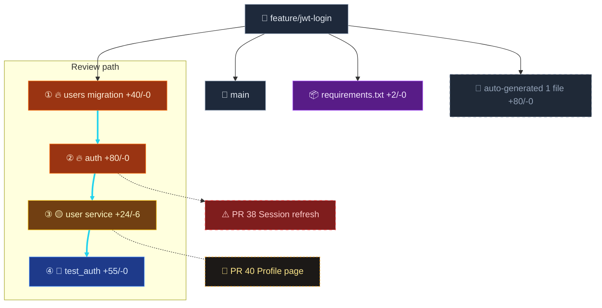

# PRism 🔺

Show a clear flowchart of a GitHub pull request. Follow these steps in order. Do not skip steps. Use plain language in the HTML and in your short chat reply.

## 1. Parse the PR

Input: $ARGUMENTS (for example `/prism 23` or `/prism https://github.com/OWNER/REPO/pull/23`). If it is empty, use the PR number or link the user wrote in chat; if there is none, ask for it.

- If the user gave a number, use that number in the current repo.
- If the user gave a URL like `https://github.com/OWNER/REPO/pull/123`, use repo `OWNER/REPO` and number `123`. Pass `--repo OWNER/REPO` to every `gh` command.
- First run `gh auth status`. If it fails, stop and tell the user to run `gh auth login`.

## 2. Fetch PR data

Run:

```bash
gh pr view <N> --json number,title,body,author,state,baseRefName,headRefName,files,commits,additions,deletions,mergeable,mergedAt,url
gh pr diff <N>
```

Skim the diff so you can say what each module does. If the diff is huge (about 2000+ lines or 40+ files), use `gh pr diff <N> --name-only`, then read only the important files: risky files first, then the largest modules.

## 3. Conflict check

If the PR is **merged** or **closed**: say conflicts are already resolved or no longer apply, and skip this step.

If the PR is **open**:

1. Run `gh pr list --base <baseRefName> --state open --limit 100 --json number,title,headRefName,files,mergeable`. Drop this PR from the list.
2. Find other open PRs that touch the same files. Call these the **sharing PRs**, and note the shared files for each.
3. Decide if you can run a **real check**. All of these must be true:
   - `gh repo view --json nameWithOwner -q .nameWithOwner` prints the PR's `OWNER/REPO` (ignore case). That means the current folder is a local clone of the PR's repo.
   - `git version` is 2.38 or newer.
   - `git rev-parse --is-shallow-repository` prints `false`.
4. **Real check.** Never check out, never touch the working tree, and never change the user's branches. Use the remote whose URL contains `OWNER/REPO` in `git remote -v` (usually `origin`). Fetch the base and the PR heads into a private `refs/prism/` namespace, in one command (with no sharing PRs, fetch only the base and this PR):

   ```bash
   git fetch --no-tags --quiet --no-write-fetch-head <remote> \
     +refs/heads/<baseRefName>:refs/prism/base \
     +pull/<N>/head:refs/prism/pr-<N> \
     +pull/<M>/head:refs/prism/pr-<M>   # one line per sharing PR
   ```

   Then run `git merge-tree`, once for this PR against the base, and once against each sharing PR:

   ```bash
   git merge-tree --write-tree --name-only --no-messages refs/prism/base refs/prism/pr-<N>
   git merge-tree --write-tree --name-only --no-messages refs/prism/pr-<N> refs/prism/pr-<M>
   ```

   Read each result:
   - **Exit 0**: merges cleanly. The output is one line, a tree id.
   - **Exit 1, and the first line is a 40-character tree id**: real conflict. The lines after the tree id are the conflicted files.
   - **Anything else** (for example exit 1 with no tree id for a bad ref, or exit 128 for unrelated histories): the check failed for that pair. Treat that pair as file overlap only.

   Classify each sharing PR:
   - **Real conflict**: merge-tree reports conflicted files. Keep only files in that PR's shared files, because an out-of-date PR can also report its own conflicts with the base. If none are left, call it clean overlap. If the sharing PR's `mergeable` is `CONFLICTING`, add "PR M is also out of date with <base>".
   - **Overlap, merges cleanly**: same files, no conflict.

   Against the base: conflicted files mean this PR conflicts with the base branch. This replaces `mergeable`, which can be stale or `UNKNOWN`.

   Last, always delete the private refs, even if something failed:

   ```bash
   git for-each-ref --format='%(refname)' refs/prism/ | while read -r r; do git update-ref -d "$r"; done
   ```

5. **Fallback.** If any check in item 3 is not true, or the fetch fails, use file overlap only: every sharing PR is a **potential conflict**, and `mergeable` = `CONFLICTING` means this PR conflicts with the base. Note the reason in one short phrase, for example "not run in a local clone of OWNER/REPO", "git is older than 2.38", "shallow clone", or "git fetch failed". The page must say it is file overlap only and why.

## 4. Group files, mute noise, classify

Split files into **real code** and **generated**.

**Generated** (mute these): lockfiles, `*.lock`, `*.snap`, migration snapshots, schema snapshots, and files under `dist/`, `build/`, `generated/`, `__generated__/`, `vendor/`, plus `*.min.*`. Put all of them in **one** node: `🤖 auto-generated N files +X/-Y`. Do not put this node on the review path. Do not include its lines in the "real code" headline. Still show a "total +A/-B" chip that counts every file.

**Overview map:** group the remaining real files by top-level folder or module. Keep the whole map to about **10-12 nodes** (branches and the generated node count toward this). Merge small leftover groups into `other N files`. The overview shows modules only, not individual files. Files belong in `{{FILES_JSON}}`, so a click can reveal them.

**Classify** each real module:
- 🟢 added · 🟡 modified · 🔴 deleted
- 🧪 tests — test files or folders
- 📦 dependencies — manifests like `package.json` or `requirements.txt` (lockfiles are generated, not this)
- 🔥 risky — auth, security, migrations, config, CI, permissions, payments
- Risky wins over added or modified. Tests stay 🧪.

## 5. Risk, review path, and diagram

**Risk meter 🔥** — start at 1, add the points below, cap at 10. Level: 1-3 low, 4-6 medium, 7-10 high.

- Auth, permissions, or security: +3
- Real schema or migration changes (not only a generated snapshot): +2
- Config or CI: +1
- Dependency manifest changes: +1
- Real code size: +1 if real additions are 500-1499, +2 if 1500 or more
- Tests: +2 if the change has no tests, +1 if tests look thin next to the real code
- Conflicts (count once, use the highest): +2 for a real conflict with the base branch or another open PR; +1 if there is only clean overlap (same files, merges cleanly). In the fallback: +2 if `mergeable` is `CONFLICTING` or another open PR overlaps files.

Give 2-4 short reasons that match the points you added.

**Review path 🧭** — pick the order a reviewer should read the modules, usually: data/schema → core logic → API → clients → tests/docs. Skip the generated node, branch nodes, conflict nodes, and overlap nodes. Number the path modules ① ② ③ in their labels. Draw the path with thick arrows `==>` in that order, then color those arrows cyan with `linkStyle` (link index starts at 0, in the order links appear; the example below shows this). For each step, write one plain line that says why to look there.

**Diagram** — prefer `flowchart TB` so the review path reads top to bottom. Use a subgraph for the path, in order. Keep labels short: `① emoji module +adds/-dels`. Use fewer edges and fewer crossings. If you cannot infer flow, link `HEAD` to the first review node and to side nodes only. Other PRs: a real conflict is a node with class `conflict`, label `⚠️ PR 38 title`, linked `AUTH -.-> C38`. A clean overlap is a node with class `overlap`, label `🔀 PR 40 title`, linked without an arrowhead `USER -.- O40`. In the fallback, draw every sharing PR as `conflict`. Link each one from the module that holds the shared files. After every module node (including generated), add `click ID call showNode("ID")`.

**Colors** — always include these `classDef` rules:

```
classDef branch fill:#1e293b,stroke:#94a3b8,color:#e2e8f0
classDef added fill:#14532d,stroke:#22c55e,color:#dcfce7
classDef modified fill:#713f12,stroke:#eab308,color:#fef9c3
classDef deleted fill:#7f1d1d,stroke:#ef4444,color:#fee2e2
classDef tests fill:#1e3a8a,stroke:#3b82f6,color:#dbeafe
classDef deps fill:#581c87,stroke:#a855f7,color:#f3e8ff
classDef risky fill:#9a3412,stroke:#f97316,color:#ffedd5
classDef generated fill:#1f2937,stroke:#64748b,color:#94a3b8,stroke-dasharray:5 5
classDef conflict fill:#7f1d1d,stroke:#ef4444,color:#fecaca,stroke-dasharray:5 5
classDef overlap fill:#1c1917,stroke:#f59e0b,color:#fde68a,stroke-dasharray:3 3
```

**Mermaid syntax rules** (or the diagram will fail): unique ids of letters and numbers only (never `end`); always quote labels; avoid `()`, `[]`, and `#` even inside quotes (write `PR 38`, not `PR #38`); paste raw Mermaid into the template, no fences.

## 6. PR type, before/after, and affected features

Pick exactly one PR type from the title, commit messages, and diff:
- **New feature** — added files or routes that introduce a capability
- **Improves a feature** — extends or changes an existing capability
- **Bug fix** — fix/bug keywords and a small diff
- **Removes a feature** — removed files, routes, or a capability
- **Refactor (no behaviour change)** — renames or moves with no behaviour change
- **Docs/config** — only markdown, yaml, or config

**Before and after** — two short plain-English lines, from a user or developer view of app behaviour: `Before: ...` then `After: ...`.

**Affected features** — list existing features that use the changed code. In the local repo, run `rg` for callers or imports of the changed functions and files. Use a short name (2–4 words) for each. Mark each **breaking**, **may break**, **changed**, or **safe**, and output them in that order (breaking first, safe last). Put any short reason in the `title` attribute only, not as visible text. If a change is breaking (removed or renamed public API, changed config or env, a DB migration, or a changed response shape), mark it **breaking** and add the reason in `title`. If nothing existing is touched, write: `No existing features affected (new code only)`.

## 7. Copy this style

Fake PR `#42` Add JWT login, `feature/jwt-login` → `main`, open, real code +201 / -6, total +281 / -6 because of one generated lockfile +80 / -0. Real check ran in a local clone: merges cleanly with `main`; real conflict with open PR 38 Session refresh in `src/api/auth.py`; open PR 40 Profile page also edits `src/services/user.py` but merges cleanly. Risk 9/10 high: auth +3, migration +2, deps +1, real conflict +2.

PR type: New feature.
Before: The API had no JWT login, so users could not sign in with a token.
After: Users can sign in with a JWT. A users migration stores the new login data, and the user service wires it in.
Affected (pills, breaking first): Users database (breaking — adds a users migration); Auth API (may break — conflicts with open PR 38 in auth.py); User service (changed).

Review path: ① users migration → ② auth → ③ user service → ④ tests.



## 8. Write the HTML file

1. Read `template.html` from the skill folder, usually `~/.claude/skills/prism/template.html`.
2. Replace these placeholders exactly:
   - `{{TITLE}}` — PR number and title. Example: `#42 Add JWT login`
   - `{{META}}` — HTML chips. The first chip is always the PR type badge (see below):

     ```html
     <span class="pr-type-badge type-new">New feature</span>
     <span class="chip">owner/repo</span>
     <span class="chip">#42</span>
     <span class="chip">by alice</span>
     <span class="chip">🌿 feature/jwt-login → 🎯 main</span>
     <span class="chip chip-state open">Open</span>
     <span class="chip">real code +201 / -6</span>
     <span class="chip chip-muted">total +281 / -6</span>
     ```

     State chip: `chip chip-state open`, `merged`, or `closed`.
   - PR type badge (goes inside `{{META}}`, first) — exactly one badge. Class: `type-new`, `type-improves`, `type-fix`, `type-removes`, `type-refactor`, or `type-docs`.

     ```html
     <span class="pr-type-badge type-new">New feature</span>
     ```

     Labels: New feature, Improves a feature, Bug fix, Removes a feature, Refactor (no behaviour change), Docs/config.
   - `{{BEFORE_AFTER}}` — two short plain-English lines:

     ```html
     <div class="before-after">
       <p><strong>Before:</strong> The API had no JWT login, so users could not sign in with a token.</p>
       <p><strong>After:</strong> Users can sign in with a JWT. A users migration stores the new login data, and the user service wires it in.</p>
     </div>
     ```

   - `{{AFFECTED}}` — existing features as one wrapping row of short-name pills, in this order: `is-breaking`, `may-break`, `changed`, `safe`. Put any reason in the `title` attribute only. If none:

     ```html
     <div class="affected">
       <h2>Affected features</h2>
       <p class="affected-empty">No existing features affected (new code only)</p>
     </div>
     ```

     Otherwise:

     ```html
     <div class="affected">
       <h2>Affected features</h2>
       <ul class="affected-list">
         <li><span class="feat-pill is-breaking" title="Adds a users migration">Users database</span></li>
         <li><span class="feat-pill may-break" title="Conflicts with open PR 38 in auth.py">Auth API</span></li>
         <li><span class="feat-pill changed">User service</span></li>
       </ul>
     </div>
     ```

   - `{{SUMMARY}}` — exactly three `<li>` bullets: what changed, why it matters, and any risk or conflict.
   - `{{CONFLICTS}}` — one box per kind, in this order, and skip empty kinds. End with one `conflicts-note` line that says how it was checked.
     - `conflicts-real` — real conflicts, with the base branch first, then other PRs. List the conflicted files.
     - `conflicts-overlap` — other PRs that edit the same files but merge cleanly.
     - `conflicts-ok` — the base check passed, or nothing was found.

     ```html
     <div class="conflicts-real">
       <p class="conflicts-head">⚠️ Real conflicts</p>
       <ul>
         <li><strong>PR 38 Session refresh</strong> conflicts in <code>src/api/auth.py</code></li>
       </ul>
     </div>
     <div class="conflicts-overlap">
       <p class="conflicts-head">🔀 Overlap, merges cleanly</p>
       <ul>
         <li><strong>PR 40 Profile page</strong> also edits <code>src/services/user.py</code></li>
       </ul>
     </div>
     <div class="conflicts-ok">Merges cleanly with <code>main</code> ✅</div>
     <p class="conflicts-note">Checked with <code>git merge-tree</code> against the latest <code>main</code> and open PR heads.</p>
     ```

     A base conflict goes first in `conflicts-real`: `<li><strong>main</strong> (base branch) conflicts in <code>src/app.py</code></li>`, and then drop the `conflicts-ok` box.

     **Fallback** (file overlap only): put sharing PRs in `conflicts-warn` as potential conflicts, and say why in the note:

     ```html
     <div class="conflicts-warn">
       <p class="conflicts-head">⚠️ Potential conflicts</p>
       <ul>
         <li><strong>PR 38 Session refresh</strong> also edits <code>src/api/auth.py</code></li>
       </ul>
     </div>
     <p class="conflicts-note">File overlap only, not a real merge check: not run in a local clone of acme/api.</p>
     ```

     Open with nothing found: `<div class="conflicts-ok">No conflicts found ✅</div>` plus the note. Merged or closed: `<div class="conflicts-ok">This PR is already merged. Conflicts are resolved.</div>` (say "closed" when it is closed), with no note.
   - `{{RISK}}` — use this shape (level class is `low`, `medium`, or `high` on both `risk-level` and `risk-fill`; fill width is score times 10%):

     ```html
     <div class="risk-meter" data-score="9" data-level="high">
       <div class="risk-head"><span class="risk-num">9</span><span class="risk-max">/10</span><span class="risk-level high">High</span></div>
       <div class="risk-bar"><div class="risk-fill high" style="width:90%"></div></div>
       <ul class="risk-reasons">
         <li>Touches auth and a new JWT login path</li>
         <li>Adds a users migration</li>
         <li>Updates requirements.txt</li>
         <li>Real conflict with open PR 38 in auth.py</li>
       </ul>
     </div>
     ```

   - `{{REVIEW_PATH}}` — an `<ol class="review-steps">` of the path. Each item: `<li><span class="step-num">①</span><div><strong>module</strong><p>Why look here.</p></div></li>`
   - `{{DIAGRAM}}` — raw Mermaid only, no fences.
   - `{{FILES_JSON}}` — one JSON object, no fences. Keys are node ids. Value: `{"label":"auth","files":[{"path":"src/api/auth.py","add":80,"del":0,"status":"risky","generated":false}]}`. `status` is added, modified, deleted, tests, deps, risky, or generated. Use real paths when you have them; if you only have a module label, use that label as `path`. Do not invent paths.
   - Before writing, check that no `{{` text is left in the page. Every placeholder must be replaced.
3. Where to write it:
   - **Default (temporary):** write to a hidden folder in the current project: `./.prism/pr-<N>.html` (create the folder). Keep it out of git without touching tracked files: if inside a git repo, append `.prism/` to `$(git rev-parse --git-common-dir)/info/exclude` when it is not already there. Never edit `.gitignore`. It stays inside the project so the editor or Claude app preview can open it.
   - **Save only if asked:** if the input or chat says `save` (for example `/prism 741 save`) or the user asks to keep it, write to `./prism-output/pr-<N>.html` in the current working directory instead.
4. Do NOT open the file or a browser yourself. Never run `open`, `xdg-open`, or `start`. The user decides where to view it.

## 9. Reply in chat

Reply with only:

1. One line: what the PR does.
2. One line: main modules changed, with real-code +adds / -dels (and total if generated files were muted).
3. One line: risk score and conflict status (real conflicts, clean overlaps, or "file overlap only" with the reason).
4. A clickable link to the page, as a Markdown link with the absolute path, like `[🔺 Open PR #<N> map](file:///absolute/path/pr-<N>.html)`. Use the real absolute path of the file you wrote (use `pwd`). If it is the temporary copy, add: "Temporary view in `.prism/` (ignored by git). Run `/prism <N> save` to keep it in `prism-output/`." On the next line, also print the plain absolute path so it can be copied into any browser or editor preview. Then add one more line with a command the user can copy to open it, in a code block: `open <absolute path>` on macOS (`xdg-open` on Linux, `start` on Windows). Only show this command; never run it yourself.

Do not paste the Mermaid or a long report in chat.
