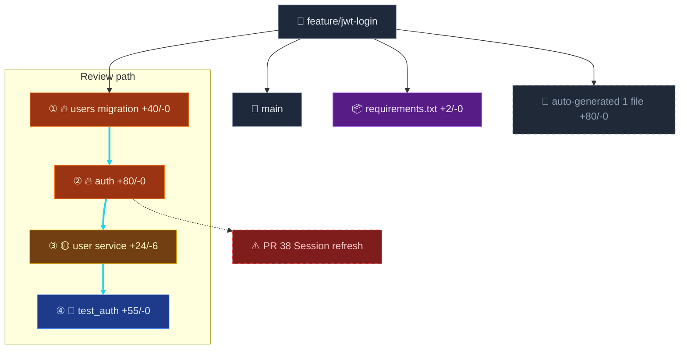

# PRism 🔺

Show a clear flowchart of a GitHub pull request. Follow these steps in order. Do not skip steps. Use plain language in the HTML and in your short chat reply.

## 1. Parse the PR

Input: $ARGUMENTS (for example `/prism 23` or `/prism https://github.com/OWNER/REPO/pull/23`). If it is empty, use the PR number or link the user wrote in chat; if there is none, ask for it.

- If the user gave a number, use that number in the current repo.
- If the user gave a URL like `https://github.com/OWNER/REPO/pull/123`, use repo `OWNER/REPO` and number `123`. Pass `--repo OWNER/REPO` to every `gh` command you run yourself.

## 2. Collect the facts with the script

The script `prism_collect.py` (in the skill folder) does the counting, grouping, overlap check, and risk score. Its numbers are the source of truth. Do not recount lines, regroup files, or redo the risk math yourself.

1. Run it with the number or URL exactly as the user gave it:

   ```bash
   python3 ~/.claude/skills/prism/prism_collect.py <N or URL> --save "${TMPDIR:-/tmp}/prism-pr-<N>.json"
   ```

2. If it exits non-zero, stop and tell the user its `message`. Exit 2: install `gh`. Exit 3: run `gh auth login`. Exit 4: wrong PR number or link. Exit 5: `gh` failed.
3. It prints one short JSON object (long file lists are cut to 10, with the rest counted in `files_more`; the saved file has everything):
   - `pr` — repo, number, title, url, author, state, base, head, mergeable, body, commit headlines.
   - `totals.real` and `totals.all` — files, additions, deletions for real code and for all files. `totals.generated` is the muted part.
   - `tests` — `present`, `thin`, test and code line counts.
   - `conflicts` — see step 3.
   - `risk` — `score`, `level`, `percent`, and `reasons` (points and why).
   - `modules` — the map nodes: `id`, `label`, `status`, `mermaid_class`, `node_label`, `on_review_path`, `files`.
   - `read_plan` — `big`, `important_files`, `risky_files`.
   - Saved file only: `files` (every file with its flags) and `files_json` (ready for `{{FILES_JSON}}`).
4. Read the code so you can write the prose (what each module does). Skip generated files.
   - If `read_plan.big` is `false`: run `gh pr diff <N>`.
   - If `read_plan.big` is `true` (about 2000+ real lines or 40+ real files): do not read the full diff. Read only the files in `read_plan.important_files` (risky first, then the largest), one at a time:

     ```bash
     gh api repos/OWNER/REPO/pulls/<N>/files --paginate --jq '.[] | select(.filename=="PATH") | .patch'
     ```

## 3. Conflicts (from the script)

- If `conflicts.checked` is `true` (the PR is **open**):
  1. `conflicts.overlaps` lists other open PRs on the same base that touch the same `files`. Those are potential conflicts.
  2. `generated_only: true` means they share only generated files such as a lockfile. Mention it briefly; it adds no risk.
  3. If `conflicts.conflicting_with_base` is `true`, say this PR already conflicts with the base branch.
  4. If `conflicts.error` is set, say the overlap check could not run.
- If the PR is **merged** or **closed**: say conflicts are already resolved or no longer apply.

## 4. How the script groups and classifies files

This is a summary of what `prism_collect.py` does, so you can explain it. Do not apply it by hand. If this text and the script ever disagree, the script wins.

**Generated** (muted): lockfiles (`package-lock.json`, `yarn.lock`, `pnpm-lock.yaml`, `go.sum`, any `*.lock`, and similar), `*.snap`, snapshot data files (migration or schema snapshots), `*.min.*`, and files under `dist/`, `build/`, `generated/`, `__generated__/`, `vendor/`, or `__snapshots__/`. They all go in **one** node, `GEN`: `🤖 auto-generated N files +X/-Y`. It is not on the review path and its lines are not in the "real code" totals. `totals.all` still counts every file.

**Classify** each real file:
- 🟢 added · 🟡 modified (renamed counts as modified) · 🔴 deleted
- 🧪 tests — files in folders like `test/`, `tests/`, `__tests__/`, `spec/`, `e2e/`, or named like `test_*.py`, `*_test.go`, `*.test.ts`, `*.spec.js`, `*Test.java`
- 📦 dependencies — manifests like `package.json`, `requirements.txt`, `pyproject.toml`, `go.mod`, `Cargo.toml`, `Gemfile` (lockfiles are generated, not this)
- 🔥 risky — path words for auth, security, or permissions (`auth`, `login`, `oauth`, `jwt`, `session`, `token`, `secret`, `permission`), migrations or schema, config (`config`, `settings`, `.env`, `Dockerfile`, `*.tf`), CI (`.github/workflows/` and similar), payments. Tests, deps, docs, and generated files are never risky.
- One status per file: generated, then tests, then deps, then deleted, then risky, then added or modified. So risky wins over added or modified, and tests stay 🧪.

**Overview map:** all tests go in one `TESTS` node, all dependency manifests in one `DEPS` node, and generated files in `GEN`. The other real files are grouped by top-level folder. If there is room, the biggest folder is split one level deeper. If there are too many groups, the smallest go into `OTHER` (`other N files`). The whole map is capped at about **10 nodes**, counting `HEAD` and `BASE`; conflict nodes come on top. The map shows modules only; the files are in `files_json`, so a click can reveal them.

## 5. Risk, review path, and diagram

**Risk meter 🔥** — use `risk.score`, `risk.level`, and `risk.percent` as they are. The script starts at 1, adds these points, and caps at 10. Level: 1-3 low, 4-6 medium, 7-10 high.

- Auth, permissions, or security: +3
- Real schema or migration changes (not only a generated snapshot): +2
- Config or CI: +1
- Dependency manifest changes: +1
- Real code size: +1 if real additions are 500-1499, +2 if 1500 or more
- Tests: +2 if code lines were added and no test file changed, +1 if tests look thin (code additions 100+ and test additions under a fifth of them)
- Conflicts: +2 if `mergeable` is `CONFLICTING` or another open PR overlaps real (not only generated) files
- Payments make a file 🔥 risky but add no points.

Turn `risk.reasons` into 2-4 short plain lines, one per reason (merge the smallest if there are more than 4). Do not add reasons the script did not give.

**Review path 🧭** — pick the order a reviewer should read the `modules`, usually: data/schema → core logic → API → clients → tests/docs. Skip modules with `on_review_path: false` (the generated node), branch nodes, and conflict nodes. Number the path modules ① ② ③ in their labels. Draw the path with thick arrows `==>` in that order, then color those arrows cyan with `linkStyle` (link index starts at 0, in the order links appear; the example below shows this). For each step, write one plain line that says why to look there.

**Diagram** — use one node per entry in `modules`. Keep each module's `id` exactly as the node id, so `files_json` and the clicks match. Start from its `node_label` (`emoji label +adds/-dels`): you may shorten or rename the label text into plain words and add ① ② ③, but keep the emoji and the +/- numbers. Use `mermaid_class` in the `class` lines. Prefer `flowchart TB` so the review path reads top to bottom. Use a subgraph for the path, in order. Use fewer edges and fewer crossings. If you cannot infer flow, link `HEAD` to the first review node and to side nodes only. Add one dashed conflict node per overlapping PR, for example `C38["⚠️ PR 38 Session refresh"]` and `AUTH -.-> C38` (if there are many, show the 2-3 with the most real shared files). After every module node (including generated), add `click ID call showNode("ID")`.

**Colors** — always include these `classDef` rules:

```
classDef branch fill:#1e293b,stroke:#94a3b8,color:#e2e8f0
classDef added fill:#14532d,stroke:#22c55e,color:#dcfce7
classDef modified fill:#713f12,stroke:#eab308,color:#fef9c3
classDef deleted fill:#7f1d1d,stroke:#ef4444,color:#fee2e2
classDef tests fill:#1e3a8a,stroke:#3b82f6,color:#dbeafe
classDef deps fill:#581c87,stroke:#a855f7,color:#f3e8ff
classDef risky fill:#9a3412,stroke:#f97316,color:#ffedd5
classDef generated fill:#1f2937,stroke:#64748b,color:#94a3b8,stroke-dasharray:5 5
classDef conflict fill:#7f1d1d,stroke:#ef4444,color:#fecaca,stroke-dasharray:5 5
```

**Mermaid syntax rules** (or the diagram will fail): unique ids of letters and numbers only (never `end`); always quote labels; avoid `()`, `[]`, and `#` even inside quotes (write `PR 38`, not `PR #38`); paste raw Mermaid into the template, no fences.

## 6. PR type, before/after, and affected features

Pick exactly one PR type from the title, commit messages, and diff:
- **New feature** — added files or routes that introduce a capability
- **Improves a feature** — extends or changes an existing capability
- **Bug fix** — fix/bug keywords and a small diff
- **Removes a feature** — removed files, routes, or a capability
- **Refactor (no behaviour change)** — renames or moves with no behaviour change
- **Docs/config** — only markdown, yaml, or config

**Before and after** — two short plain-English lines, from a user or developer view of app behaviour: `Before: ...` then `After: ...`.

**Affected features** — list existing features that use the changed code. In the local repo, run `rg` for callers or imports of the changed functions and files. Use a short name (2–4 words) for each. Mark each **breaking**, **may break**, **changed**, or **safe**, and output them in that order (breaking first, safe last). Put any short reason in the `title` attribute only, not as visible text. If a change is breaking (removed or renamed public API, changed config or env, a DB migration, or a changed response shape), mark it **breaking** and add the reason in `title`. If nothing existing is touched, write: `No existing features affected (new code only)`.

## 7. Copy this style

Fake PR `#42` Add JWT login, `feature/jwt-login` → `main`, open, real code +201 / -6, total +281 / -6 because of one generated lockfile +80 / -0. Overlaps `src/api/auth.py` with open PR 38 Session refresh. Risk 9/10 high: auth +3, migration +2, deps +1, overlap +2.

PR type: New feature.
Before: The API had no JWT login, so users could not sign in with a token.
After: Users can sign in with a JWT. A users migration stores the new login data, and the user service wires it in.
Affected (pills, breaking first): Users database (breaking — adds a users migration); Auth API (may break — overlaps open PR 38 on auth.py); User service (changed).

Review path: ① users migration → ② auth → ③ user service → ④ tests.



## 8. Write the HTML file

1. Read `template.html` from the skill folder, usually `~/.claude/skills/prism/template.html`.
2. Replace these placeholders exactly:
   - `{{TITLE}}` — PR number and title. Example: `#42 Add JWT login`
   - `{{META}}` — HTML chips. The first chip is always the PR type badge (see below):

     ```html
     <span class="pr-type-badge type-new">New feature</span>
     <span class="chip">owner/repo</span>
     <span class="chip">#42</span>
     <span class="chip">by alice</span>
     <span class="chip">🌿 feature/jwt-login → 🎯 main</span>
     <span class="chip chip-state open">Open</span>
     <span class="chip">real code +201 / -6</span>
     <span class="chip chip-muted">total +281 / -6</span>
     ```

     State chip: `chip chip-state open`, `merged`, or `closed`. Take the numbers for "real code" from `totals.real` and for "total" from `totals.all`.
   - PR type badge (goes inside `{{META}}`, first) — exactly one badge. Class: `type-new`, `type-improves`, `type-fix`, `type-removes`, `type-refactor`, or `type-docs`.

     ```html
     <span class="pr-type-badge type-new">New feature</span>
     ```

     Labels: New feature, Improves a feature, Bug fix, Removes a feature, Refactor (no behaviour change), Docs/config.
   - `{{BEFORE_AFTER}}` — two short plain-English lines:

     ```html
     <div class="before-after">
       <p><strong>Before:</strong> The API had no JWT login, so users could not sign in with a token.</p>
       <p><strong>After:</strong> Users can sign in with a JWT. A users migration stores the new login data, and the user service wires it in.</p>
     </div>
     ```

   - `{{AFFECTED}}` — existing features as one wrapping row of short-name pills, in this order: `is-breaking`, `may-break`, `changed`, `safe`. Put any reason in the `title` attribute only. If none:

     ```html
     <div class="affected">
       <h2>Affected features</h2>
       <p class="affected-empty">No existing features affected (new code only)</p>
     </div>
     ```

     Otherwise:

     ```html
     <div class="affected">
       <h2>Affected features</h2>
       <ul class="affected-list">
         <li><span class="feat-pill is-breaking" title="Adds a users migration">Users database</span></li>
         <li><span class="feat-pill may-break" title="Overlaps open PR 38 on auth.py">Auth API</span></li>
         <li><span class="feat-pill changed">User service</span></li>
       </ul>
     </div>
     ```

   - `{{SUMMARY}}` — exactly three `<li>` bullets: what changed, why it matters, and any risk or conflict.
   - `{{CONFLICTS}}` — overlaps in `<div class="conflicts-warn">...</div>`. Merged or closed: `<div class="conflicts-ok">This PR is already merged. Conflicts are resolved.</div>` (say "closed" when it is closed). Open with no overlap: `<div class="conflicts-ok">No conflicts found ✅</div>`.
   - `{{RISK}}` — use this shape with `risk.score`, `risk.level` (class `low`, `medium`, or `high` on both `risk-level` and `risk-fill`), and `risk.percent` as the fill width. The reasons are your plain lines from `risk.reasons`:

     ```html
     <div class="risk-meter" data-score="9" data-level="high">
       <div class="risk-head"><span class="risk-num">9</span><span class="risk-max">/10</span><span class="risk-level high">High</span></div>
       <div class="risk-bar"><div class="risk-fill high" style="width:90%"></div></div>
       <ul class="risk-reasons">
         <li>Touches auth and a new JWT login path</li>
         <li>Adds a users migration</li>
         <li>Updates requirements.txt</li>
         <li>Overlaps open PR 38 on auth</li>
       </ul>
     </div>
     ```

   - `{{REVIEW_PATH}}` — an `<ol class="review-steps">` of the path. Each item: `<li><span class="step-num">①</span><div><strong>module</strong><p>Why look here.</p></div></li>`
   - `{{DIAGRAM}}` — raw Mermaid only, no fences.
   - `{{FILES_JSON}}` — leave this placeholder as it is. Step 4 fills it from the script's `files_json` (keys are the module ids, values like `{"label":"auth","files":[{"path":"src/api/auth.py","add":80,"del":0,"status":"risky","generated":false}]}`). Do not type file lists yourself.
   - Replace every other placeholder.
3. Where to write it:
   - **Default (temporary):** write to a hidden folder in the current project: `./.prism/pr-<N>.html` (create the folder). Keep it out of git without touching tracked files: if inside a git repo, append `.prism/` to `$(git rev-parse --git-common-dir)/info/exclude` when it is not already there. Never edit `.gitignore`. It stays inside the project so the editor or Claude app preview can open it.
   - **Save only if asked:** if the input or chat says `save` (for example `/prism 741 save`) or the user asks to keep it, write to `./prism-output/pr-<N>.html` in the current working directory instead.
4. Fill the file list, then check that no `{{` text is left (the `grep` must print `0`):

   ```bash
   python3 ~/.claude/skills/prism/prism_collect.py --fill-files <page path> "${TMPDIR:-/tmp}/prism-pr-<N>.json"
   grep -c '{{' <page path>
   ```

5. Do NOT open the file or a browser yourself. Never run `open`, `xdg-open`, or `start`. The user decides where to view it.

## 9. Reply in chat

Reply with only:

1. One line: what the PR does.
2. One line: main modules changed, with real-code +adds / -dels (and total if generated files were muted).
3. One line: risk score and conflict status.
4. A clickable link to the page, as a Markdown link with the absolute path, like `[🔺 Open PR #<N> map](file:///absolute/path/pr-<N>.html)`. Use the real absolute path of the file you wrote (use `pwd`). If it is the temporary copy, add: "Temporary view in `.prism/` (ignored by git). Run `/prism <N> save` to keep it in `prism-output/`." On the next line, also print the plain absolute path so it can be copied into any browser or editor preview. Then add one more line with a command the user can copy to open it, in a code block: `open <absolute path>` on macOS (`xdg-open` on Linux, `start` on Windows). Only show this command; never run it yourself.

Do not paste the Mermaid or a long report in chat.
