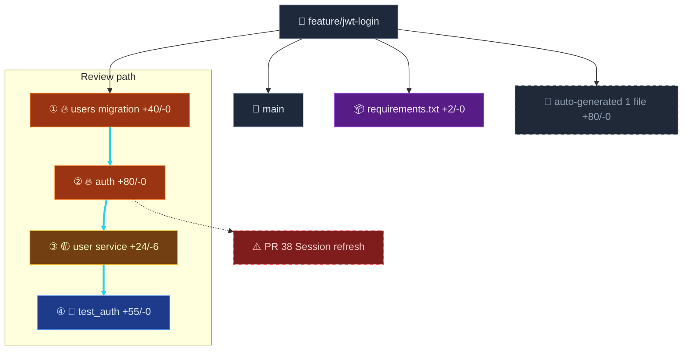

<!-- prism -->
## 🔺 PRism: #42 Add JWT login

**New feature** · `feature/jwt-login` → `main` · real code +201 / -6 · total +281 / -6

**Before:** The API had no JWT login, so users could not sign in with a token.

**After:** Users can sign in with a JWT. A users migration stores the new login data, and the user service wires it in.

### 🔥 Risk: 9/10 (High)

- Touches auth and a new JWT login path
- Adds a users migration
- Updates requirements.txt
- Overlaps open PR 38 on auth

### ⚠️ Conflicts

- Potential conflict with **PR 38 Session refresh** on `src/api/auth.py`. This PR is still mergeable with `main`.

### 🧭 Review path

1. **users migration** — New tables the login flow writes to.
2. **auth** — JWT login is the new entry point, and it overlaps PR 38.
3. **user service** — Wires login into the existing user logic.
4. **tests** — Check that the new login path is covered.

### 🗺️ PR map

📁 Modules and files (6 modules, 6 files)

| Module | File | Status | +/- |
|---|---|---|---|
| ① users migration | `db/users_migration.sql` | 🔥 risky | +40/-0 |
| ② auth | `src/api/auth.py` | 🔥 risky | +80/-0 |
| ③ user service | `src/services/user.py` | 🟡 modified | +24/-6 |
| ④ test_auth | `tests/test_auth.py` | 🧪 tests | +55/-0 |
| requirements.txt | `requirements.txt` | 📦 deps | +2/-0 |
| 🤖 auto-generated | `poetry.lock` | 🤖 generated | +80/-0 |

Generated by PRism for commit a1b2c3d. Re-run /prism 42 comment to update.
